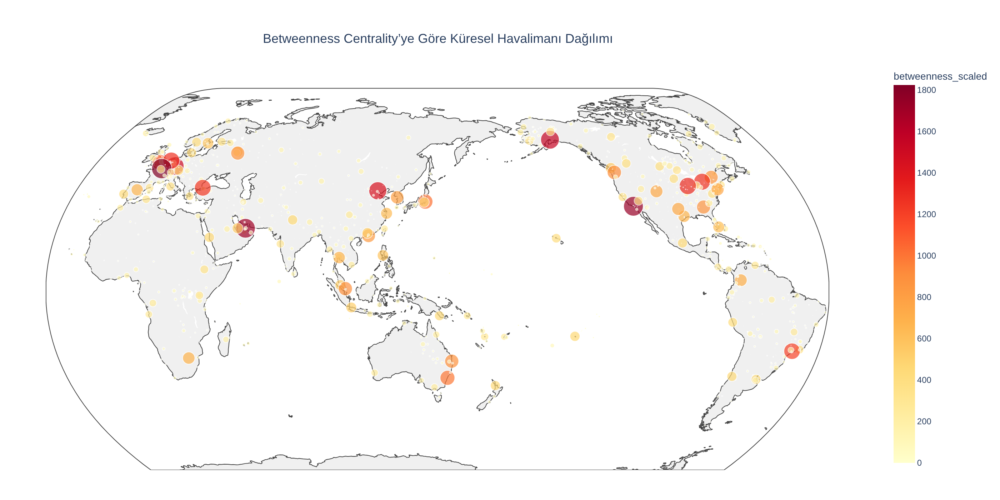

# Global Airport Network Analysis - Finding the "Silent but Vital" Airports

**Which airports would cause the widest disruption if they went down - and are they really just the biggest hubs?**

I modelled the global air route network as a directed graph of **6,072 airports and 37,042 connections** and
compared three centrality measures to find out. The answer: no. Some of the most critical bridge airports in the
network have relatively few connections, so ranking airports by size alone misses them.

🌍 **Interactive maps:** [melikegllnv.github.io/global-airport-network-analysis](https://melikegllnv.github.io/global-airport-network-analysis/)



---

## Key findings

**1. The busiest airport is not always the most critical one.**
Anchorage (ANC) ranks **282nd** by number of connections but **4th** by betweenness centrality. As the gateway that links
Alaska's many remote airports to the rest of the world, it sits on a large share of the network's shortest paths.

| Betweenness rank | Airport | City | Degree rank |
|:---:|:---:|---|:---:|
| 1 | CDG | Paris | 2 |
| 2 | LAX | Los Angeles | 24 |
| 3 | DXB | Dubai | 11 |
| **4** | **ANC** | **Anchorage** | **282** |
| 5 | FRA | Frankfurt | 1 |
| 6 | PEK | Beijing | 7 |
| 7 | ORD | Chicago | 6 |
| 8 | YYZ | Toronto | 27 |
| 9 | AMS | Amsterdam | 3 |
| 10 | IST | Istanbul | 4 |

**2. "Silent but vital" regional bridges.** Several airports with modest connectivity rank in the global top 100 for
betweenness because they are the only link between a region and the rest of the network:

| Airport | Region it connects | Degree rank | Betweenness rank |
|:---:|---|:---:|:---:|
| YQT Thunder Bay | Northern Ontario, Canada | 705 | 67 |
| FAI Fairbanks | Interior Alaska | 551 | 70 |
| BET Bethel | Western Alaska | 535 | 62 |
| YZF Yellowknife | Northwest Territories, Canada | 483 | 68 |
| HIR Honiara | Solomon Islands | 476 | 82 |
| VLI Port Vila | Vanuatu | 442 | 78 |

**3. Each measure answers a different operational question.** Degree shows local traffic intensity, betweenness shows
bridge and transfer roles, and closeness shows network-wide accessibility. Only together do they give a reliable
picture of criticality.

## Why it matters for airport operations (AIM perspective)

From an Aeronautical Information Management (AIM) point of view, the results suggest:

- **Monitoring priorities:** decision-support systems should watch high-betweenness airports closely, not only the largest hubs.
- **Early warning:** disruptions (weather, NOTAMs, closures) at bridge airports can cascade across regions and should trigger earlier alerts.
- **Capacity planning:** centrality rankings can be one data-driven input when prioritising infrastructure and resilience investments.

## Data

[OpenFlights](https://openflights.org/data) open dataset (`airports.dat`, `routes.dat`), loaded directly from the
[OpenFlights GitHub repository](https://github.com/jpatokal/openflights).

| Step | Airports | Routes / edges |
|---|---:|---:|
| Raw data | 7,698 | 67,663 routes |
| After cleaning (valid 3-letter IATA codes, complete source/destination) | 6,072 | 37,042 unique directed connections |

> **Limitation:** OpenFlights route data is a historical snapshot (last major update around 2014), so it does not reflect
> recent changes such as the 2019 move of Istanbul's main hub from Atatürk Airport to İstanbul Airport.
> The method itself can be re-run on any current route dataset.

## Method

1. **Load & clean** — remove airports without IATA codes and routes with missing endpoints (pandas).
2. **Build the network** — airports as nodes, scheduled routes as directed edges (NetworkX `DiGraph`).
3. **Centrality analysis** — degree, betweenness and closeness centrality for every airport.
4. **Visualise** — interactive geospatial maps for each measure (Plotly).
5. **Export** — full ranking table for all 6,072 airports.

## Repository structure

```
├── notebooks/
│   └── airport_network_centrality_analysis.ipynb   # full analysis (Turkish commentary)
├── outputs/
│   ├── centrality_results.csv                       # centrality values, sorted by betweenness
│   └── Appendix_B_All_Airports_Centrality_Rankings.csv  # all airports with ranks for each measure
├── docs/                                            # interactive maps (GitHub Pages)
├── images/                                          # static map previews
└── requirements.txt
```

## How to run

```bash
pip install -r requirements.txt
jupyter notebook notebooks/airport_network_centrality_analysis.ipynb
```

The data is downloaded automatically from OpenFlights. The full run takes under a minute on a laptop.
You can also open the notebook directly in [Google Colab](https://colab.research.google.com/).

## Tools

Python · pandas · NetworkX · Plotly · Jupyter / Google Colab

---

*This project is based on my MSc graduation project at Hacettepe University, Graduate School of Informatics
(Information Systems), supervised by Prof. Dr. Şahap Armağan Tarım.*

**Melike Gullanova** · [GitHub](https://github.com/MelikeGllnv) · melike.gllnv@gmail.com
